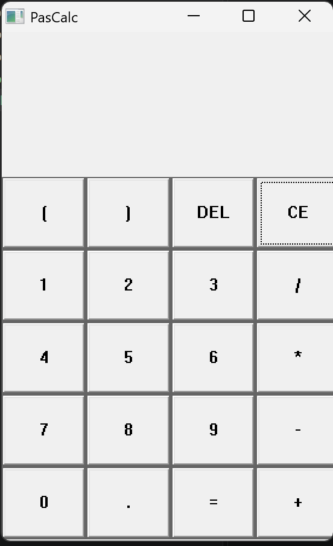

# Pascalc  

## What is it  
Pascalc is a simple calculator written in pascal for the funzies. It uses plain win32 for it's gui and fpexprpars as the maths parser

## Features  
It features anything a normal calculator has, aka  
multiplication  
addition  
subtracton  
division  
brackets  
syntax checking  
and more

## Building

Its super simple, you need to install freepascal and then run  
`fpc -Mobjfpc -Sh gui_app.pas`  
and its done!  

